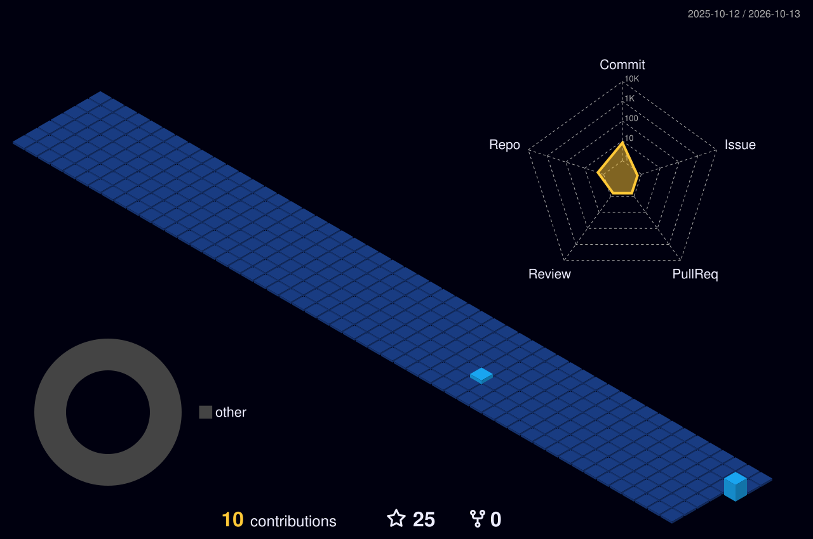

# 👋 Hey there! I'm Abdifitah Yusuf Mohamud!

  

  
  
  

---

## 💻 About Me 🚀

I'm a **Software Engineer**, **Asterisk IVR Engineer**, and **Project Manager** with **7+ years of programming experience** and a **Master's Degree in Project Management**.

I develop full-stack business software, web applications, APIs, and Asterisk-powered telephony solutions. I enjoy bridging software engineering and delivery leadership: turning real operational needs into reliable, maintainable products.

**Currently focused on:** full-stack applications, Asterisk IVR & call center systems, integrations, and effective technology project delivery.

---

## ☎️ Featured Project: CaawiyeIVR

**CaawiyeIVR** is a **call center web application** that I built around my work with **Asterisk and IVR systems**.

It brings together web application development and telephony engineering to support call center operations and communication workflows.

---

## 🛠️ Skills and Tools

I work across **Frontend**, **Backend**, **Databases**, **Infrastructure**, and **Telephony**, with project management expertise supporting delivery.

### Frontend & Backend Development

### IVR, Telephony & Call Center Engineering

### Databases & DevOps

### Design & Project Management

**Project planning** · **Delivery management** · **Stakeholder coordination** · **Requirements analysis** · **Technical leadership**

---

## 🔥 My GitHub Stats

### Contribution Activity

### Contribution History — 3D View

### 🐍 Watch My Contributions Get Eaten!

<picture>
  <source media="(prefers-color-scheme: dark)" srcset="https://raw.githubusercontent.com/duceysane10/duceysane10/output/github-contribution-grid-snake-dark.svg" />
  <source media="(prefers-color-scheme: light)" srcset="https://raw.githubusercontent.com/duceysane10/duceysane10/output/github-contribution-grid-snake.svg" />
  
</picture>

---

### 🌍 Somalia GitHub Contribution Ranking

Ranking is supplied by the independent committers.top leaderboard, not by GitHub. If not listed, the badge may show “unranked”.

---

### 🤝 Let's Connect

I'm interested in software engineering, Asterisk telephony, IVR systems, call center applications, and technology project management.

**[Portfolio](https://engduceysane.dct.so)** · **[GitHub](https://github.com/duceysane10)** · **[Email](mailto:engduceysane10@gmail.com)**

 

**Thanks for visiting my profile!** 🚀

